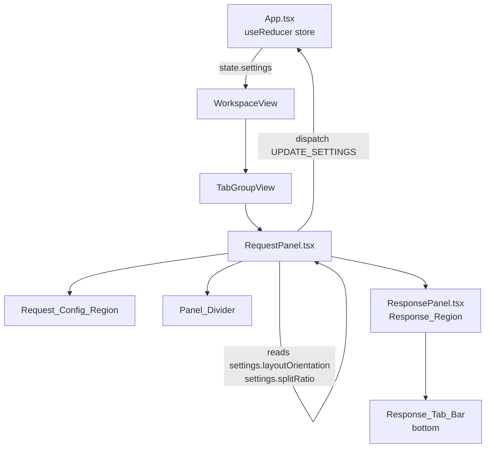
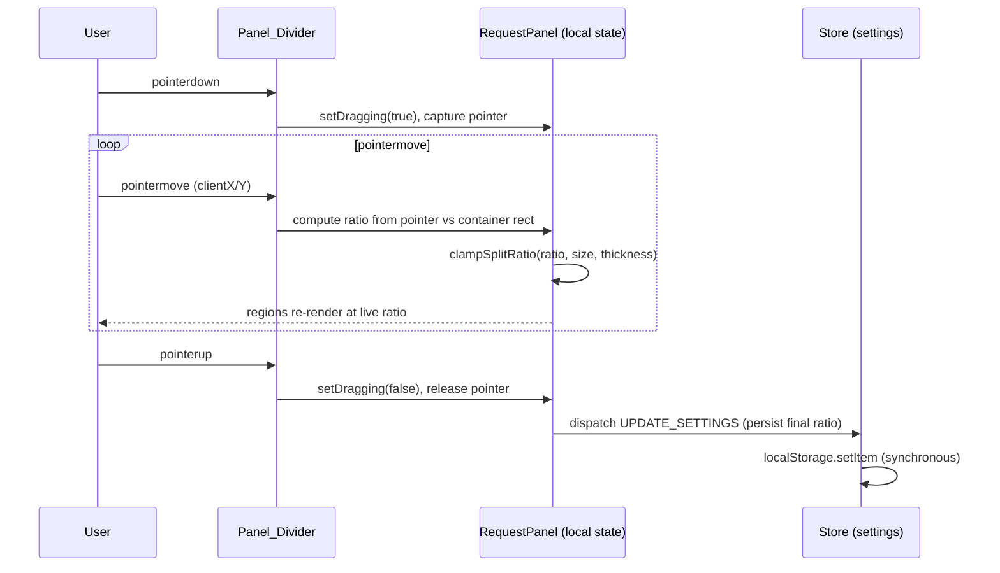

# Design Document

## Overview

This feature replaces the fixed two-`flex-1` split inside `RequestPanel.tsx` with a user-controlled, resizable layout. It introduces:

1. A **draggable Panel_Divider** between the Request_Config_Region (URL sub-tabs + content) and the Response_Region (`ResponsePanel`), with the split ratio constrained so neither region falls below 200px.
2. A **Layout_Toggle** that switches Layout_Orientation between `stacked` (response below) and `side-by-side` (response to the right), reorienting the divider accordingly.
3. A **redesigned Response_Tab_Bar** in `ResponsePanel.tsx`, moved from the top of the region to the **bottom edge**, with Body / Headers / Cookies tabs, count indicators, and status/time/size metadata, all styled with theme CSS variables.

The Layout_Preference (orientation + split ratio) is **persisted globally on `SettingsModel`** (key `httphub_settings`) and loaded through a backward-compatible normalizer so existing saved data without these fields loads with sensible defaults.

### Storage Scope Decision

The requirements (R4.7) mandate that Layout_Preference live in an existing `localStorage` key (`httphub_workspaces` or `httphub_settings`) with no new key, but leave the scope (per-request, per-tab-group, or global) to the design phase. Three options were considered:

| Scope | Stored on | Pros | Cons |
| --- | --- | --- | --- |
| Per-request | `RequestModel` (`httphub_workspaces`) | Each request remembers its own layout | Massive duplication across every tab; migration must touch every request object; debounced 1s save couples a *view* preference to request *data*; layout would reset visually as the user switches tabs |
| Per-tab-group | `TabGroupModel` (`httphub_workspaces`) | Layout shared by tabs in a group | Still data-coupled; multiple migration points; inconsistent layout between groups is rarely what users want |
| **Global (chosen)** | `SettingsModel` (`httphub_settings`) | Single source of truth; one migration point; synchronous save in the reducer trivially satisfies the "within 1 second" persistence rules; layout is a *view* preference, not request data; consistent across all panels | All panels share one layout (acceptable and arguably desirable for a multi-pane tool) |

**Decision:** Store Layout_Preference globally on `SettingsModel`. Rationale: the divider position and orientation describe *how the user prefers to view* the request/response split, not properties of any individual request. This matches the existing precedent that `fontSize` and `theme` (also view-level preferences) live on `SettingsModel`. The settings reducer path already persists synchronously and is the same `dispatch`/reducer flow required by R4.6, and it keeps `httphub_workspaces` (request data) untouched, which directly satisfies the migration guarantee in R5.3 (all other saved request/tab/workspace fields are byte-for-byte preserved because we never write to that key for this feature).

## Architecture

### Component responsibilities



- **`store.tsx`** owns the persisted Layout_Preference on `SettingsModel`, a `normalizeLayoutPreference` helper used at load time, and a pure `clampSplitRatio` helper used at drag/load time. Settings continue to persist synchronously inside the `UPDATE_SETTINGS` reducer case.
- **`RequestPanel.tsx`** reads `layoutOrientation` and `splitRatio` from `state.settings`, renders the two regions plus the Panel_Divider in the correct flex direction, owns the live pointer-drag interaction (local state during drag, dispatch on release), and renders the Layout_Toggle near the URL bar.
- **`ResponsePanel.tsx`** moves its tab bar to the bottom edge, renders counts and metadata, and keeps its existing Monaco/headers/cookies content.

### Drag interaction model

The divider drag uses pointer events on a measured container:



During a drag the live ratio is held in **local component state** so we do not write to `localStorage` on every `pointermove`. On `pointerup` we dispatch a single `UPDATE_SETTINGS`, which persists synchronously and well within the 1-second budget (R4.2). The Layout_Toggle dispatches `UPDATE_SETTINGS` immediately on click (R4.1).

### Sizing math

Regions are sized with flex-basis percentages derived from `splitRatio` (the Request_Config_Region's share), so the combined size always equals the available space minus the divider thickness (R1.4). The container is measured with a `ref` + `getBoundingClientRect()` (and a `ResizeObserver`) to convert pointer position and the 200px minimums into ratio bounds:

- `axisSize` = container width (side-by-side) or height (stacked), in pixels.
- `DIVIDER_THICKNESS` = 6px; `MIN_REGION_PX` = 200px.
- usable = `axisSize - DIVIDER_THICKNESS`.
- `minRatio` = `MIN_REGION_PX / usable`; `maxRatio` = `1 - (MIN_REGION_PX / usable)`.
- If `usable < 2 * MIN_REGION_PX` (i.e. `axisSize < 400 + 6`), the bounds collapse/cross; we then pin each region at 200px and ignore reducing drags (R1.8).

## Components and Interfaces

### `SettingsModel` additions (store + types)

```ts
export type LayoutOrientation = 'stacked' | 'side-by-side';

export interface SettingsModel {
  fontSize: number;
  theme: 'dark' | 'monako' | 'cyberpunk' | 'light';
  layoutOrientation: LayoutOrientation; // NEW
  splitRatio: number;                   // NEW: Request_Config_Region share, 0..1
}
```

### Pure helpers (in `store.tsx`)

All pure layout logic lives in `store.tsx` alongside the reducer and persistence functions. There is no separate `src/layout.ts` module — keeping these helpers next to the reducer matches the existing `loadSettings`/`loadWorkspaces` precedent and lets the `UPDATE_SETTINGS` case reuse them directly.

```ts
export const LAYOUT_DEFAULTS = { layoutOrientation: 'stacked' as LayoutOrientation, splitRatio: 0.5 };
export const DIVIDER_THICKNESS = 6; // px
export const MIN_REGION_PX = 200;   // px

// Clamp a ratio to the [minRatio, maxRatio] window implied by the 200px minimums.
// When the panel is too small to honor both minimums (usable < 2 * MIN_REGION_PX),
// returns 0.5 so the view layer pins both regions at their 200px minimum.
export function clampSplitRatio(ratio: number, axisSize: number, thickness = DIVIDER_THICKNESS): number;

// Compute the pixel size of each region from a (clamped) ratio and axis size.
// configPx + responsePx === axisSize - thickness for all inputs.
export function computeRegionSizes(
  ratio: number,
  axisSize: number,
  thickness = DIVIDER_THICKNESS
): { configPx: number; responsePx: number };

// Validate/normalize a possibly-corrupt persisted preference into safe values.
// Falls back to LAYOUT_DEFAULTS for non-numeric / out-of-range / unknown-orientation input.
export function normalizeLayoutPreference(raw: unknown): { layoutOrientation: LayoutOrientation; splitRatio: number };
```

`loadSettings()` is updated to run the parsed object through `normalizeLayoutPreference` (in addition to the existing `{ ...defaultSettings, ...parsed }` spread) so orientation and ratio are always valid on boot (R4.4, R5.4, R5.5, R5.7).

### `RequestPanel.tsx` interface

No prop changes. Internally it gains:

```ts
const { layoutOrientation, splitRatio } = state.settings;
const isSideBySide = layoutOrientation === 'side-by-side';
const containerRef = useRef<HTMLDivElement>(null);
const [dragRatio, setDragRatio] = useState<number | null>(null); // live ratio while dragging
const effectiveRatio = dragRatio ?? splitRatio;

const toggleOrientation = () =>
  dispatch({ type: 'UPDATE_SETTINGS', updater: s => ({
    ...s, layoutOrientation: s.layoutOrientation === 'stacked' ? 'side-by-side' : 'stacked'
  })});

const commitRatio = (ratio: number) =>
  dispatch({ type: 'UPDATE_SETTINGS', updater: s => ({ ...s, splitRatio: ratio })});
```

- The container switches between `flex-col` (stacked) and `flex-row` (side-by-side).
- Each region uses `style={{ flexBasis: \`${share * 100}%\` }}` with `flex-grow:0; flex-shrink:0; min-width/height:200px`.
- The Panel_Divider is a `<div>` with `role="separator"`, `cursor-row-resize`/`cursor-col-resize`, a ≥6px hit target along the axis, and `onPointerDown`/`onPointerMove`/`onPointerUp` handlers using `setPointerCapture`.
- The Layout_Toggle is a button next to the Send control / sub-tab row using a lucide-react icon (`Rows2` when currently side-by-side → action returns to stacked; `Columns2` when currently stacked → action goes side-by-side), styled with theme variables.

### `ResponsePanel.tsx` interface

No prop changes. The tab bar `<div>` moves below the content `<div>` (DOM + flex order), keeping Body / Headers / Cookies order, with:
- Headers count = `Object.keys(response.headers).length` (0 when none).
- Cookies count = `response.cookies?.length ?? 0`.
- Active tab styled `text-accent-primary`; inactive `text-text-secondary`.
- Status/time/size metadata rendered in the same bottom bar; size uses a pure `formatSize` helper (B / KB / MB).
- Bottom border/background via `border-border-primary` / `bg-bg-secondary`.

## Data Models

### Persisted shape (`httphub_settings`)

```jsonc
{
  "fontSize": 14,
  "theme": "dark",
  "layoutOrientation": "stacked",   // 'stacked' | 'side-by-side'
  "splitRatio": 0.5                  // number in [0, 1], Request_Config_Region share
}
```

### Migration / normalization rules

`normalizeLayoutPreference(raw)` applied during `loadSettings()`:

| Input condition | Result |
| --- | --- |
| Field absent | default (`stacked` / `0.5`) — R5.1, R5.2 |
| `layoutOrientation` not in {`stacked`, `side-by-side`} | `stacked` — R4.4, R5.4 |
| `splitRatio` non-numeric, `< 0`, or `> 1` | `0.5` — R4.5, R5.5 |
| `splitRatio` in [0,1] but violates 200px bounds | clamped via `clampSplitRatio` at render against measured size — R5.6 |
| Entire settings blob unparseable | both defaults; load continues — R5.7 |

Request/tab/workspace data in `httphub_workspaces` is **never modified** by this feature, so all previously saved fields load identical to their stored values (R5.3).

## Correctness Properties

*A property is a characteristic or behavior that should hold true across all valid executions of a system — essentially, a formal statement about what the system should do. Properties serve as the bridge between human-readable specifications and machine-verifiable correctness guarantees.*

These properties target the pure helpers in `store.tsx` (`clampSplitRatio`, `computeRegionSizes`, `normalizeLayoutPreference`, `formatSize`), the `UPDATE_SETTINGS` reducer path, and the load round-trips — all places where behavior varies meaningfully with input and many generated cases reveal edge cases cheaply. UI structure, styling, and pointer-lifecycle wiring are validated with example/component tests instead (see Testing Strategy).

The prework consolidated redundant criteria: all clamping criteria (1.3, 1.6, 1.7, 1.8, 5.6) collapse into one clamping property; all default/invalid normalization criteria (1.2, 3.8, 4.4, 5.1, 5.2, 5.4, 5.5) collapse into one normalization property; the two count criteria (2.2, 2.3) combine; and the two toggle-transition criteria (3.2, 3.3) combine into an involution.

### Property 1: Split ratio clamping keeps both regions within bounds

*For any* container axis size and *any* candidate ratio (including values outside `[0, 1]`, non-finite values, and ratios derived from a pointer position anywhere along the axis), `clampSplitRatio` returns a ratio such that, when the panel can honor both 200px minimums (usable space ≥ `2 * MIN_REGION_PX`), the Request_Config_Region is ≥ 200px, the Response_Region is ≥ 200px, and the result is the nearest in-bounds value to the input; and when usable space is less than `2 * MIN_REGION_PX`, the function returns the pinned fallback `0.5` rather than reducing either region further.

**Validates: Requirements 1.3, 1.6, 1.7, 1.8, 5.6**

### Property 2: Region sizes exactly partition the usable space

*For any* ratio and *any* container axis size, the `configPx` and `responsePx` returned by `computeRegionSizes` sum exactly to `axisSize - DIVIDER_THICKNESS`.

**Validates: Requirements 1.4**

### Property 3: Layout preference normalization yields valid values or defaults

*For any* persisted input — arbitrary objects, partial objects, wrong-typed fields, an orientation outside {`stacked`, `side-by-side`}, a `splitRatio` that is non-numeric, less than 0, or greater than 1, `null`, or `undefined` — `normalizeLayoutPreference` returns a `layoutOrientation` in {`stacked`, `side-by-side`} and a finite `splitRatio` within `[0, 1]`, substituting the defaults (`stacked`, `0.5`) for any missing or invalid field.

**Validates: Requirements 1.2, 3.8, 4.4, 5.1, 5.2, 5.4, 5.5**

### Property 4: Valid layout preference survives a save/load round-trip

*For any* valid `layoutOrientation` in {`stacked`, `side-by-side`} and *any* `splitRatio` within `[0, 1]`, persisting the preference to `httphub_settings` and then loading it back via `loadSettings` returns the same orientation and ratio.

**Validates: Requirements 4.3**

### Property 5: Layout changes are persisted immediately

*For any* layout change (a new orientation and/or a new valid ratio) applied through the `UPDATE_SETTINGS` reducer, reading `httphub_settings` back from `localStorage` yields the updated `layoutOrientation` and `splitRatio`.

**Validates: Requirements 4.1, 4.2**

### Property 6: Tab count indicators equal their collection sizes

*For any* response, the count rendered next to the Headers tab equals the number of entries in the response headers map (0 when empty), and the count rendered next to the Cookies tab equals the number of response cookies (0 when absent or empty).

**Validates: Requirements 2.2, 2.3**

### Property 7: Selected tab shows only its content with correct active styling

*For any* selected tab in {Body, Headers, Cookies}, the Response_Region renders only that tab's content, applies the theme accent color to the selected tab, and renders every unselected tab in the theme secondary text color.

**Validates: Requirements 2.4**

### Property 8: Size formatting selects the correct unit

*For any* non-negative byte count, `formatSize` returns a string whose unit is `B` for values under 1024, `KB` for values from 1024 up to 1024², and `MB` at or above 1024², the numeric portion is a parseable number, and that number multiplied back by its unit factor recovers the original byte count within display rounding.

**Validates: Requirements 2.8**

### Property 9: Orientation toggle is an involution

*For any* starting Layout_Orientation, activating the Layout_Toggle once switches `stacked` to `side-by-side` and `side-by-side` to `stacked`, and activating it twice returns the orientation to its original value.

**Validates: Requirements 3.2, 3.3**

### Property 10: Orientation change preserves request and response data

*For any* application state, dispatching an `UPDATE_SETTINGS` action that changes only layout fields produces a new state whose `state.workspaces` reference is identical to the previous state's (every request input field and displayed response is structurally unchanged), and no network request is issued.

**Validates: Requirements 3.7**

### Property 11: Loading workspaces preserves all stored fields

*For any* previously saved workspaces payload that lacks Layout_Preference fields, `loadWorkspaces` returns data deep-equal to the stored value, with every request, tab, and workspace field identical to its stored value.

**Validates: Requirements 5.3**

### Property 12: Loaders are resilient to unparseable storage

*For any* string stored under `httphub_settings` or `httphub_workspaces` (including malformed JSON), the loaders never throw and return valid state, applying the default Layout_Preference (`stacked`, `0.5`) when the settings blob cannot be parsed.

**Validates: Requirements 4.4, 5.7**

## Error Handling

- **Persistence failure (R4.5):** `UPDATE_SETTINGS` wraps `localStorage.setItem` in a `try/catch` (the existing pattern). On failure the reducer still returns the new in-memory settings so the active layout is unchanged (R4.5 first clause), and sets a transient, non-persisted boolean `settingsPersistError` flag on `state` inside the `catch` (R4.5 second clause). `RequestPanel` reads this flag and renders a small non-blocking indicator (theme-styled, lucide `AlertTriangle` with a tooltip "Layout preference could not be saved"). The flag clears (`false`) on the next successful `UPDATE_SETTINGS` and is never written to `localStorage`.
- **Unparseable persisted settings (R5.7):** `loadSettings` already catches `JSON.parse` errors and returns `defaultSettings`; we additionally route the parsed object through `normalizeLayoutPreference` so a partially-corrupt blob (valid JSON, invalid layout fields) still yields valid defaults without throwing.
- **Invalid / out-of-range persisted layout fields (R4.4, R5.4, R5.5):** repaired by `normalizeLayoutPreference` during hydration.
- **Panel too small to honor minimums (R1.8):** handled in the view layer by `clampSplitRatio` returning the `0.5` fallback when usable space cannot fit both minimums; both regions pin at 200px via CSS guards and the divider stops responding to drags that would shrink a region below its minimum (no error surfaced — this is expected behavior).
- **Container not yet measured / zero measured size:** before the first `getBoundingClientRect`/`ResizeObserver` measurement (or when `axisSize <= 0`), the panel renders using the stored `splitRatio` directly with the CSS `min-width`/`min-height: 200px` guards providing a safe fallback; clamping is reapplied once a positive measurement is available.

## Testing Strategy

### Dual approach

- **Property-based tests** cover the universal properties (Properties 1–12) over large generated input spaces.
- **Unit / example tests** cover specific interactions and edge cases.
- **Smoke / review** items verify conventions that don't vary with input.

### Tooling

No test runner is configured yet. Per the tech steering note, set up **Vitest** (aligns with the Vite toolchain) and **fast-check** for property-based testing, plus `@testing-library/react` with `jsdom` for component tests. Add a `"test": "vitest run"` script and document it in `tech.md`.

> Run tests once with `vitest run` (not watch mode) in CI/agent contexts.

### Property-based testing applicability

PBT **is** appropriate for this feature because the core logic — `clampSplitRatio`, `computeRegionSizes`, `normalizeLayoutPreference`, `formatSize`, the orientation toggle reducer, and the load round-trips — are pure functions / pure reducer transitions with large input spaces and clear universal invariants. The drag *interaction* and DOM layout themselves are covered by example/component tests; the math and state behind them are covered by properties.

### Property test configuration

- **Library:** [fast-check](https://github.com/dubzzz/fast-check) with **Vitest**.
- **Iterations:** each property test runs a minimum of **100 iterations** (`fc.assert(..., { numRuns: 100 })`).
- **Property-to-test mapping:** each correctness property is implemented by a **single** property-based test, tagged with a comment of the form:
  `// Feature: resizable-panel-layout, Property {number}: {property_text}`
- **Generators:**
  - axis sizes: integers spanning below-minimum (`< 406`), exactly at the boundary, and large viewports.
  - ratios: arbitrary doubles including `< 0`, `> 1`, and non-finite values for normalization/clamping; in-range values for round-trip.
  - orientations: a mix of valid values and arbitrary strings/`undefined` for normalization.
  - persisted preferences: arbitrary objects via `fc.anything()` for normalization robustness.
  - responses: arbitrary header maps and cookie arrays (including empty) for count and rendering properties.
  - byte counts: non-negative integers (`fc.nat()`) across the B/KB/MB boundaries for `formatSize`.
  - workspaces payloads: arbitrary nested request/tab/workspace structures for the load-preservation property.
- **Pure-logic isolation:** `clampSplitRatio`, `computeRegionSizes`, `normalizeLayoutPreference`, `formatSize`, and the `reducer` are exported and tested without rendering. Properties 4, 5, 11, and 12 exercise `loadSettings` / `loadWorkspaces` / the `UPDATE_SETTINGS` reducer against a mocked `jsdom` `localStorage`. Property 10 runs the real `reducer` against generated states, asserts referential equality of `workspaces`, and asserts no `fetch` occurs. Rendering-dependent properties (6, 7) use `@testing-library/react`.

### Unit / example tests

- Divider element presence with `role="separator"`, correct `aria-orientation`, and cursor class per orientation (R1.1, R1.9).
- Pointer lifecycle: simulated pointerdown → move → up dispatches on release and retains the ratio (R1.5).
- Response tab bar position and Body/Headers/Cookies order (R2.1); Body active by default (R2.5); empty-cookies message when Cookies selected with zero cookies (R2.6); status/time/size metadata visible (R2.8 presence).
- Layout toggle present with action-reflecting lucide icon (R3.1); arrangement per orientation flips `flex-col`/`flex-row` and divider axis (R3.4, R3.5); URL value + Send preserved across toggle (R3.6).
- Save-failure: mock `localStorage.setItem` to throw → in-memory layout retained and `settingsPersistError` set (R4.5).

### Integration test

- Round-trip through the real store: render `RequestPanel`, drag the divider, toggle orientation, then re-mount reading from `localStorage` and assert the restored layout matches (R4.1, R4.2, R4.3 end-to-end).

### Convention checks (smoke / review)

- No hard-coded hex colors in the modified components; theme CSS variables only (R2.7, R3.9).
- Only `httphub_settings` / `httphub_workspaces` keys are written; no new storage key (R4.7).
- Layout changes flow through `dispatch`/`UPDATE_SETTINGS` (R4.6).

### Requirements coverage summary

| Requirement | Covered by |
| --- | --- |
| 1.1, 1.9 | Example tests |
| 1.2 | Property 3 |
| 1.3, 1.6, 1.7, 1.8, 5.6 | Property 1 |
| 1.4 | Property 2 |
| 1.5 | Example test |
| 2.1, 2.5, 2.6 | Example / edge tests |
| 2.2, 2.3 | Property 6 |
| 2.4 | Property 7 |
| 2.7 | Smoke / review |
| 2.8 | Property 8 (formatting) + example test (meta presence) |
| 3.1, 3.4, 3.5, 3.6 | Example tests |
| 3.2, 3.3 | Property 9 |
| 3.7 | Property 10 |
| 3.8 | Property 3 |
| 3.9 | Smoke / review |
| 4.1, 4.2 | Property 5 |
| 4.3 | Property 4 |
| 4.4 | Property 3 / Property 12 |
| 4.5 | Example test |
| 4.6, 4.7 | Smoke / review |
| 5.1, 5.2, 5.4, 5.5 | Property 3 |
| 5.3 | Property 11 |
| 5.7 | Property 12 |
